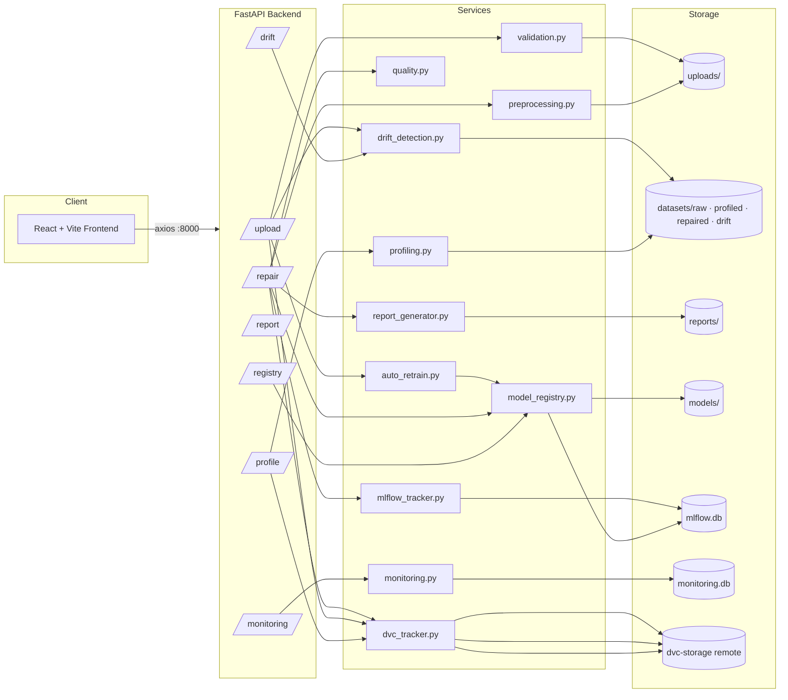

<div align="center">

# DataPrep

### AI-Powered Dataset Repair & MLOps Platform

Transform raw, messy CSV data into a trusted, ML-ready dataset — profiled, cleaned,
quality-scored, versioned, tracked, and monitored, end to end.

[](backend/requirements.txt)
[](backend/app/main.py)
[](frontend/package.json)
[](frontend/package.json)
[](backend/requirements.txt)
[](backend/requirements.txt)
[](backend/requirements.txt)
[](.github/workflows/ci.yml)

[Quickstart](#getting-started) · [Features](#features) · [Architecture](#architecture) · [API Docs](http://localhost:8000/docs) · [Roadmap](#roadmap)

</div>

---

## Overview

DataPrep is a full-stack MLOps platform built around one problem: **raw datasets are
never clean enough to model on.** You upload a CSV, and the platform takes it through
a complete, auditable pipeline — statistical profiling, missing-value imputation,
duplicate and outlier handling, label-error detection, and a weighted quality score
— before handing back a production-ready dataset and a downloadable PDF report.

What sets it apart from a one-off cleaning script is that every stage is wired into
real MLOps infrastructure: each dataset version is tracked with **DVC**, every repair
run is logged as an **MLflow** experiment, the fitted imputers/outlier detectors are
pushed into a **Model Registry** with stage promotion, incoming uploads are checked
for **data drift** against the previous version, and detected drift can **trigger
automatic retraining and redeployment** of the fitted models — all visible from a
live **Monitoring** dashboard.

## Features

- **CSV Upload & Validation** — extension/size/readability checks, schema validation via Pandera (min rows/columns, duplicate/empty column names)
- **Statistical Profiling** — basic info, missing-value and duplicate analysis, numerical/categorical statistics, correlation matrix
- **Dataset Repair Engine** — a fully data-driven pipeline, no hardcoded per-dataset rules:
  - Structural fixes (whitespace, empty rows/columns)
  - Type inference & casting
  - Duplicate row removal
  - Missing-value imputation — KNN (numerical), most-frequent (categorical)
  - Outlier handling — IQR clipping, Isolation Forest removal, or flag-only, selectable per run
  - Low-variance / constant / duplicate column pruning
  - Label-error detection via CleanLab
- **Quality Scoring** — weighted score (Completeness 30% · Uniqueness 25% · Validity 25% · Consistency 20%) with before/after comparison and a letter grade
- **Report Generation** — PDF (ReportLab), structured JSON, and the cleaned CSV, all downloadable
- **MLflow Tracking** — every repair run logged as an experiment: parameters, before/after metrics, execution time, artifacts
- **DVC Versioning** — raw, profiled, and repaired datasets are each content-hashed and versioned automatically at every stage
- **Model Registry** — fitted KNN Imputer / Isolation Forest models registered per run, with Development → Staging → Production promotion
- **Drift Detection** — re-uploading a previously-seen filename triggers a KS-test feature-distribution check, missing-rate delta, and outlier-rate delta against the prior version
- **Auto-Retraining** — when drift is detected, models are automatically retrained, re-evaluated, re-registered, and promoted to Production if quality clears the bar
- **Live Monitoring** — upload/failure counts, average quality score, average repair time, recent activity feed, and registry state, auto-refreshing
- **CI** — GitHub Actions runs the backend test suite and a frontend production build on every push/PR

## Technology Stack

| Layer | Technology |
|---|---|
| Backend framework | FastAPI + Uvicorn (Python 3.13) |
| Data processing | pandas, NumPy |
| ML | scikit-learn (KNNImputer, IsolationForest, LogisticRegression), CleanLab |
| Validation | Pandera |
| Reporting | ReportLab (PDF) |
| Experiment tracking | MLflow (SQLite backend store) |
| Data versioning | DVC (local filesystem remote) |
| Backend tests | pytest, httpx |
| Frontend framework | React 19 + Vite 8 |
| Frontend routing / HTTP | react-router-dom, axios |
| Frontend animation | Framer Motion |
| Monitoring store | SQLite (independent of MLflow, so it survives MLflow-side failures) |
| CI | GitHub Actions |

## Architecture



Every route that touches data (`upload`, `profile`, `repair`) also calls into
`dvc_tracker.py`, so each stage is versioned automatically without a manual `dvc add`.

## Modules / Screens

| Page | Route | Purpose |
|---|---|---|
| Landing | `/` | Marketing/hero page, entry point |
| Login | `/login` | UI-only sign-in (see [Roadmap](#roadmap) — not yet backed by real auth) |
| Dashboard | `/dashboard` | Pipeline status, live monitoring snapshot, quick actions, API reference |
| Upload | `/upload` | CSV upload, validation feedback, drift-alert card, auto-retrain summary |
| Analysis | `/analysis` | Full statistical profile — missing values, duplicates, correlations |
| Repair Result | `/repair` | Runs the preprocessing pipeline, shows the full repair audit log |
| Quality Report | `/quality` | Before/after quality score, PDF/JSON/CSV downloads |
| Monitoring | `/monitoring` | Live stats, recent activity, Model Registry state, MLflow instructions |
| Settings | `/settings` | Configurable API base URL (stored in `localStorage`) |

## Getting Started

**Prerequisites:** Python 3.13, Node 20+, git.

```bash
git clone <repo-url> && cd MLOps
```

### Backend

```bash
cd backend
python -m venv venv
./venv/Scripts/activate        # venv\Scripts\activate.bat on cmd, source venv/bin/activate on macOS/Linux
pip install -r requirements.txt
uvicorn app.main:app --reload --host 127.0.0.1 --port 8000
```

API is now live at `http://localhost:8000`, interactive docs at `http://localhost:8000/docs`.

### Frontend

```bash
cd frontend
npm install
npm run dev
```

App is now live at `http://localhost:5173` (proxies API calls to `http://localhost:8000`).

### Optional: MLflow UI

```bash
cd backend
mlflow ui --backend-store-uri sqlite:///mlflow.db --port 5000
```

### Optional: DVC

```bash
dvc pull      # fetch tracked dataset versions from the local remote (dvc-storage/)
```

### Run the test suite

```bash
cd backend
pytest tests/ -v
```

## Deployment

This repository is currently **local-first** — there is no Docker image or hosting
configuration checked in yet, and CI (`.github/workflows/ci.yml`) intentionally stops
at build + test, with no deploy step. To run this in production you would, at minimum:

- Serve the backend behind a proper ASGI process manager (e.g. `uvicorn` with
  `gunicorn -k uvicorn.workers.UvicornWorker`) behind a reverse proxy
- Run `npm run build` in `frontend/` and serve the static `dist/` output (Vite build) from that proxy or a CDN
- Swap the MLflow/monitoring SQLite backends for a networked database if running multiple backend replicas
- Point `DATASETS_DIR` / DVC's local remote at durable, shared storage instead of a folder on disk

## Configuration

Backend configuration lives in `backend/app/config.py` (paths are resolved relative to
the file, not the working directory):

| Setting | Default | Notes |
|---|---|---|
| `UPLOAD_DIR` | `backend/uploads/` | Raw uploads + cleaned CSVs |
| `REPORTS_DIR` | `backend/reports/` | Generated PDF/JSON reports |
| `DATASETS_DIR` | `datasets/` (repo root) | DVC-tracked raw/profiled/repaired/drift data |
| `MLFLOW_TRACKING_URI` | `sqlite:///backend/mlflow.db` | MLflow backend store |
| `MLFLOW_EXPERIMENT` | `Dataset-Repair-Pipeline` | MLflow experiment name |
| `MIN_ROWS` / `MIN_COLUMNS` | `10` / `2` | Minimum dataset size accepted by validation |
| `MAX_FILE_SIZE_MB` | `50` | Upload size limit |
| `MLOPS_TEST_ROOT` (env var) | unset | Set by `tests/conftest.py` to redirect all of the above into an isolated scratch directory during pytest runs |

Frontend configuration: the API base URL defaults to `http://localhost:8000`
(`frontend/src/api.js`) and can be overridden per-browser from the **Settings** page,
which persists it to `localStorage`.

## Project-Specific Features

These are the pieces that go beyond a typical "upload → clean → download" tool:

- **Automatic DVC versioning per pipeline stage** — every `/upload`, `/profile`, and
  `/repair` call transparently `dvc add`s its output, so re-running the same file
  produces a new tracked version (v1 → v2 → v3) without any manual DVC commands.
- **Drift-aware uploads** — uploading a filename that was seen before automatically
  diffs the new data against the last version (KS test per numeric column, missing-rate
  delta, outlier-rate delta) and surfaces it in the upload response and UI.
- **Closed-loop auto-retraining** — detected drift doesn't just alert; it re-fits the
  KNN Imputer and Isolation Forest, re-scores quality, registers the new model
  versions, and auto-promotes to Production when quality ≥ 75%, auto-archiving the
  previous Production version.
- **Independent monitoring store** — `monitoring.db` is a separate SQLite log from
  MLflow specifically so failures that never reach MLflow (bad uploads, 404s,
  mid-pipeline errors) are still counted.

## Project Structure

```
MLOps/
├── backend/
│   ├── app/
│   │   ├── main.py                  # FastAPI app, router registration, CORS
│   │   ├── config.py                # Paths, MLflow URI, validation thresholds
│   │   ├── routes/
│   │   │   ├── upload.py            # POST /upload
│   │   │   ├── profile.py           # GET  /profile/{filename}
│   │   │   ├── repair.py            # POST /repair/{filename}
│   │   │   ├── report.py            # GET/POST /quality, /report, downloads
│   │   │   ├── registry.py          # GET  /registry/models, promote
│   │   │   ├── monitoring.py        # GET  /monitoring/stats
│   │   │   └── drift.py             # GET  /drift/{filename}
│   │   ├── services/
│   │   │   ├── validation.py        # File + schema validation (Pandera)
│   │   │   ├── profiling.py         # Statistical profiling
│   │   │   ├── preprocessing.py     # The real repair pipeline (8 steps)
│   │   │   ├── quality.py           # Weighted quality scoring
│   │   │   ├── report_generator.py  # PDF/JSON report building
│   │   │   ├── mlflow_tracker.py    # MLflow experiment logging
│   │   │   ├── dvc_tracker.py       # Per-stage DVC versioning
│   │   │   ├── model_registry.py    # MLflow Model Registry + promotion
│   │   │   ├── monitoring.py        # SQLite event log + timed_event()
│   │   │   ├── drift_detection.py   # KS-test / missing / outlier drift checks
│   │   │   └── auto_retrain.py      # Drift-triggered retrain/promote
│   │   └── utils/                   # file_handler.py, helpers.py
│   ├── tests/                       # pytest suite (health, upload/repair, drift)
│   ├── uploads/, reports/           # Runtime output (gitignored)
│   ├── mlflow.db, monitoring.db     # SQLite stores (gitignored)
│   └── requirements.txt
├── frontend/
│   └── src/
│       ├── pages/                   # Landing, Login, Dashboard, Upload, Analysis,
│       │                            # RepairResult, QualityReport, Monitoring, Settings
│       ├── components/              # Sidebar, NavIcons, SplashScreen, Starfield, PageTransition
│       ├── api.js                   # Axios client (base URL http://localhost:8000)
│       └── index.css                # Design system (tokens, components, layout)
├── datasets/
│   ├── raw/, profiled/, repaired/, drift/   # DVC-tracked at every stage
├── models/                          # Locally-saved .joblib copies per registered version
├── dvc-storage/                     # Local DVC remote
├── .github/workflows/ci.yml         # Backend pytest + frontend build, on every push/PR
├── plan.md                          # Phase-by-phase build log
└── ui.md                            # Design language spec (palette, type, components)
```

## Roadmap

- [ ] Real authentication on the Login page (currently a UI-only form that stores an email in `localStorage` — no backend verification)
- [ ] Containerize (Dockerfile / docker-compose) and add an actual deploy step to CI
- [ ] Networked backing stores for MLflow/monitoring so the app can run multiple backend replicas
- [ ] Batch / multi-file upload support
- [ ] Broader automated test coverage (current suite covers health, upload→profile→repair smoke tests, and drift detection unit tests)
- [ ] Re-enable and fix `npm run lint` in CI (dropped — was failing repo-wide on a pre-existing `react-hooks/set-state-in-effect` pattern, out of scope when CI was added)

## Documentation Index

- [`plan.md`](plan.md) — phase-by-phase build log for every feature in this repo
- [`ui.md`](ui.md) — design language spec: color palette, typography, component styles
- [Interactive API docs](http://localhost:8000/docs) — live Swagger UI (backend must be running)
- [MLflow UI](http://localhost:5000) — experiment/run browser (run `mlflow ui` as above)

---

<div align="center">

Built as an end-to-end MLOps learning project — dataset repair, experiment tracking,
data versioning, model registry, drift detection, and auto-retraining, all in one place.

</div>
